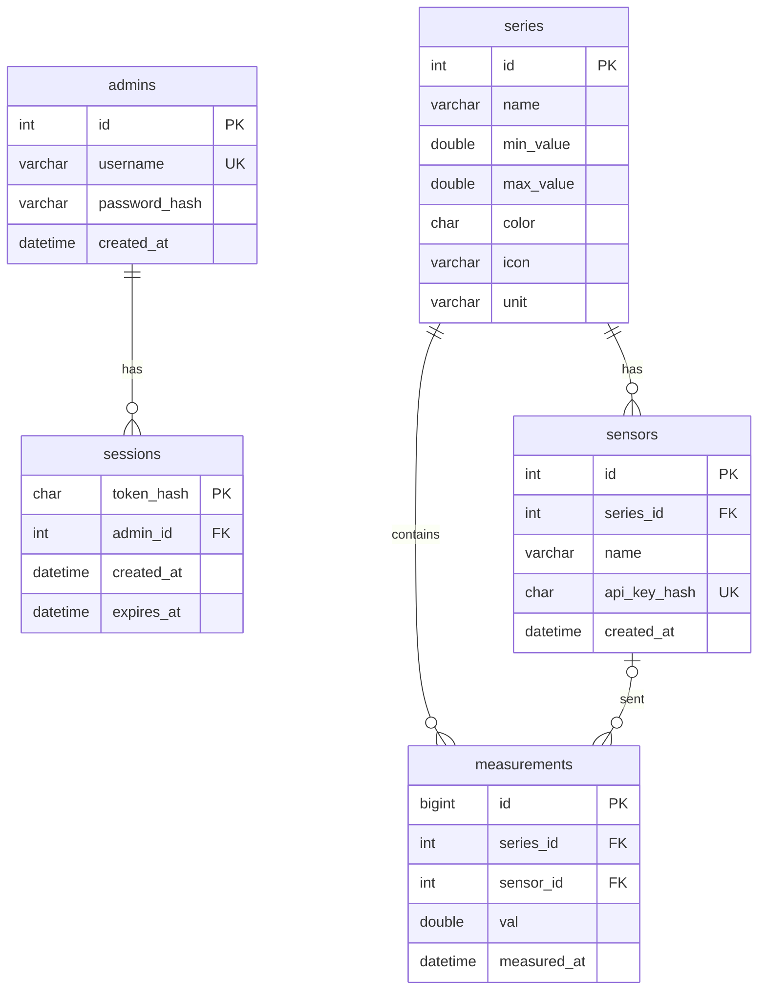

# Database model

The tables are created by `db/schema.sql` (`npm run db:init`). Times are stored in UTC.

| Table | Purpose |
| --- | --- |
| `admins` | Administrator accounts. The password is kept only as a bcrypt hash. |
| `sessions` | Active logins. A token is valid only while its hash is here and `expires_at` has not passed, so logout deletes the row. |
| `series` | A measurement series with the allowed range (`min_value` < `max_value`, checked by the database) and its look on the chart (`color`, `icon`, `unit`). |
| `sensors` | Registered sensors. Each belongs to one series and has its own API key, stored only as a SHA-256 hash. |
| `measurements` | Results. `val` is the value and `measured_at` the time of the measurement. |

Relations and delete rules:

- `sensors.series_id` -> `series.id`, `ON DELETE CASCADE`: deleting a series removes its sensors.
- `measurements.series_id` -> `series.id`, `ON DELETE CASCADE`: results disappear only together with their series.
- `measurements.sensor_id` -> `sensors.id`, `ON DELETE SET NULL`: when a sensor is unregistered its results stay and only lose the link to the sensor.
- `sessions.admin_id` -> `admins.id`, `ON DELETE CASCADE`.

Indexes: `measurements (series_id, measured_at)` for queries of chosen series in a time range, `measurements (measured_at)` for queries over all series, unique indexes on `admins.username` and `sensors.api_key_hash` (the key is looked up by its hash on every incoming result).
